# CRM Learn and Earn для управления продажами

**React · FastAPI · PostgreSQL · Python · Telegram Bot API · Docker Compose · Ubuntu VPS**

Внутренняя CRM-система для обработки заявок, управления клиентскими контактами и организации работы отдела продаж.

Проект объединял **веб-панель руководителя, два Telegram-бота, backend на FastAPI и общую базу PostgreSQL**.

Система позволяла регистрировать входящие обращения, учитывать источники заявок, назначать ответственных сотрудников и вести работу с тёплыми лидами и холодными контактами.

## Компоненты системы

| Компонент | Назначение |
|---|---|
| **Web CRM** | React-интерфейс для работы с заявками, командой, сводками и учётом продаж |
| **Entry Bot** | Telegram-интерфейс регистрации входящих заявок с сохранением источника |
| **Manager Bot** | Рабочий Telegram-интерфейс для обработки назначенных лидов, холодных контактов и уведомлений |
| **FastAPI** | Backend для бизнес-логики и взаимодействия компонентов CRM |
| **PostgreSQL** | Хранение лидов, контактов, сотрудников и связанных данных |

Компоненты CRM развёртывались с использованием Docker Compose на Ubuntu VPS. Для веб-доступа применялся Caddy с HTTPS.

## Реализованные сценарии

### Тёплые заявки

Клиент обращался через Entry Bot. Система регистрировала заявку вместе с Telegram ID и источником обращения.

После регистрации клиент получал подтверждение, а руководитель получал уведомление о новом лиде.

Руководитель вручную назначал ответственного менеджера. Назначенная заявка отражалась в CRM и рабочем Telegram-интерфейсе сотрудника.

### Работа с холодными контактами

Для холодных контактов предусматривался отдельный процесс учёта, не смешанный с входящими заявками.

Менеджер работал с назначенными контактами и фиксировал результаты обращений.

После получения содержательного ответа контакт мог переводиться в отдельный лид, который появлялся в Web CRM.

### Управление командой

В системе использовалась ролевая модель:

- **Владелец (CEO)** управлял CRM и контролировал работу отдела.
- **Руководитель отдела продаж (ROP)** работал с заявками, назначениями и сотрудниками.
- **Менеджер** обрабатывал назначенные контакты и лиды через Telegram.

Руководители работали в веб-интерфейсе, менеджеры выполняли ежедневные задачи через Telegram.

### Сводки и учёт

В Web CRM были предусмотрены разделы с заявками, ответственными сотрудниками, рабочей статистикой и записями об оплатах.

Финансовые экраны относятся к внутреннему учёту. Интеграция платёжного эквайринга и автоматические выплаты в данном кейсе не заявляются.

## Интерфейс системы

### Регистрация заявок

<table>
<tr><th>Подтверждение клиенту</th><th>Уведомление о новом лиде</th></tr>
<tr><td valign="top"></td><td valign="top"></td></tr>
</table>

### Веб-панель CRM

**Рабочая сводка**

**Управление командой**

### Telegram-интерфейсы и управление

<table>
<tr><th>События Entry Bot</th><th>Панель руководителя</th></tr>
<tr><td valign="top"></td><td valign="top"></td></tr>
</table>

**Работа с тёплыми лидами**

## Техническая архитектура

**Frontend:** React предоставляет веб-интерфейс для работы с заявками, командой и внутренними сводками.

**Backend:** Python / FastAPI реализует бизнес-логику CRM и связывает веб-интерфейс с Telegram-компонентами.

**База данных:** PostgreSQL хранит лиды, холодные контакты, пользователей и связанные записи.

**Telegram-интеграции:** Entry Bot регистрирует заявки, Manager Bot поддерживает рабочие действия сотрудников и уведомления.

**Инфраструктура:** Docker Compose, Ubuntu VPS, Caddy и HTTPS.

### Архитектура компонентов

[Открыть SVG](architecture/components.svg) · [Mermaid-исходник](architecture/components.mmd)

### Обработка тёплых и холодных контактов

[Открыть SVG](architecture/lead-flow.svg) · [Mermaid-исходник](architecture/lead-flow.mmd)

## Мой вклад

CRM создавалась с использованием **OpenAI Codex и ChatGPT**.

В рамках проекта я:

- Проектировал архитектуру CRM, пользовательские роли и сценарии обработки заявок.
- Определял логику входящих заявок, ручного назначения ответственных и раздельного учёта холодных контактов и лидов.
- Формулировал технические задачи для AI-инструментов разработки, проверял интеграции и уточнял реализацию.
- Тестировал пользовательские и административные сценарии, включая регистрацию заявок, назначение менеджеров и создание лидов из холодных контактов.
- Работал с развёртыванием React, FastAPI, PostgreSQL и Telegram-ботов на Ubuntu VPS через Docker Compose, с настройкой HTTPS.

## Статус проекта

CRM разрабатывалась, тестировалась и была развёрнута на VPS в мае 2026 года.

Сейчас проект находится в архивном состоянии: последние полные версии исходного кода и серверное окружение недоступны.

В репозитории представлены описание системы, архитектурные схемы и обезличенные изображения интерфейсов.

CRM технически самостоятельна. Автоматическая синхронизация с образовательными Free Bot и Paid Bot не заявляется.

[Материалы проекта](../docs/evidence.md#crm) · [Тестирование и ограничения](../docs/validation.md#crm-для-управления-продажами)
