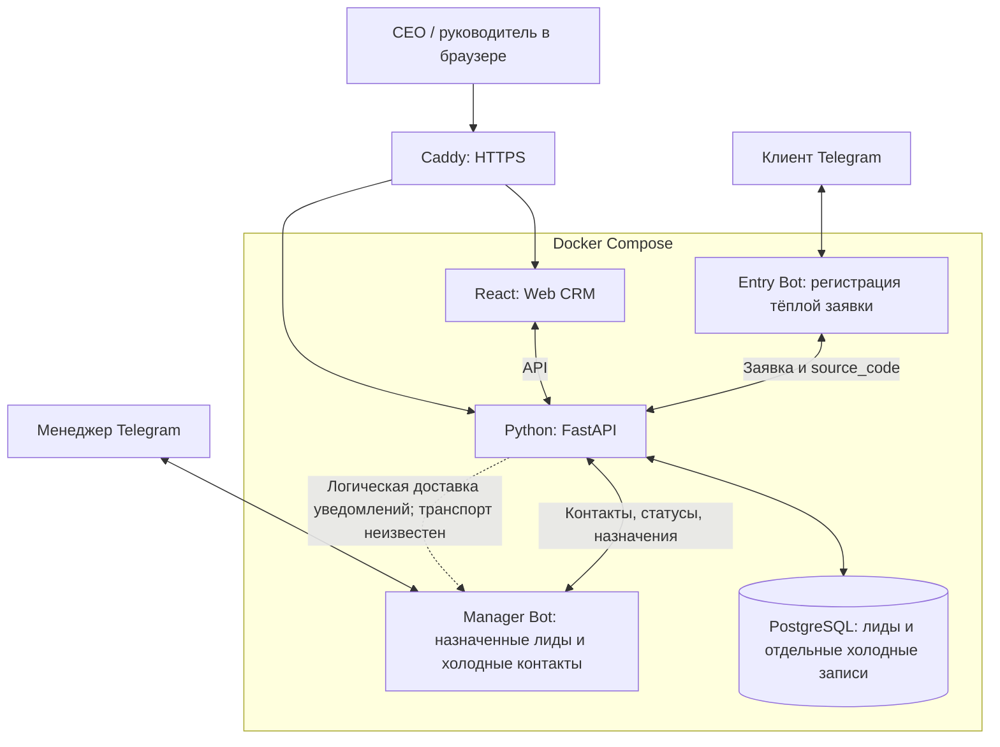
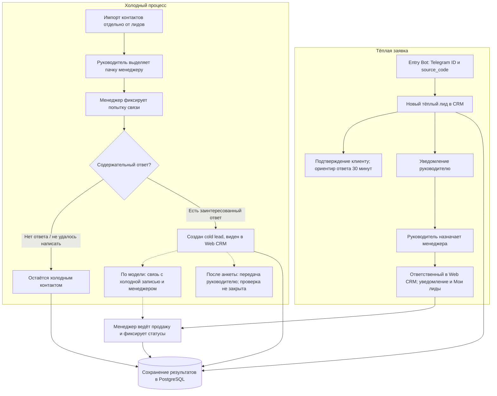
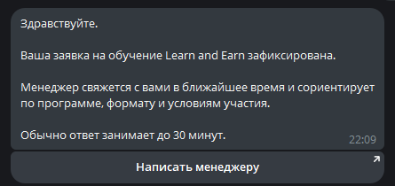
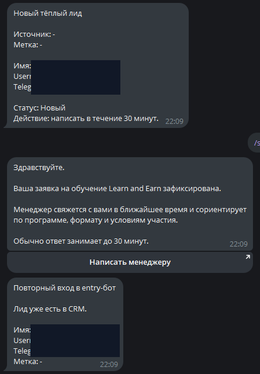
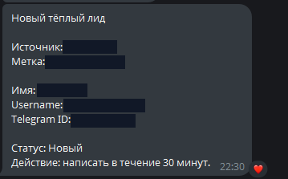
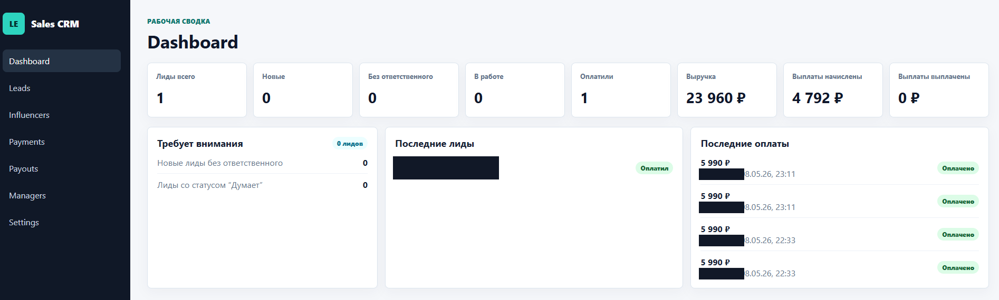
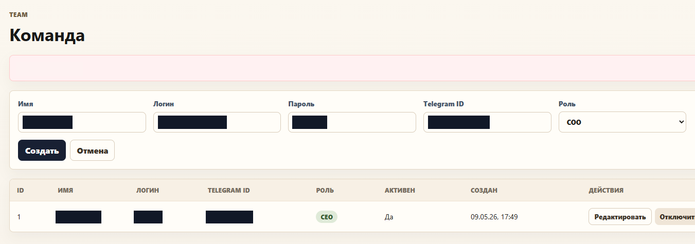
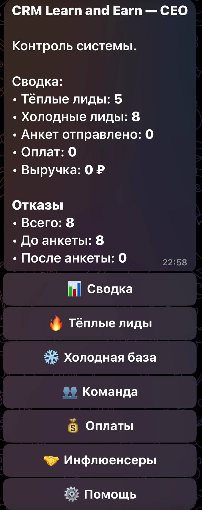
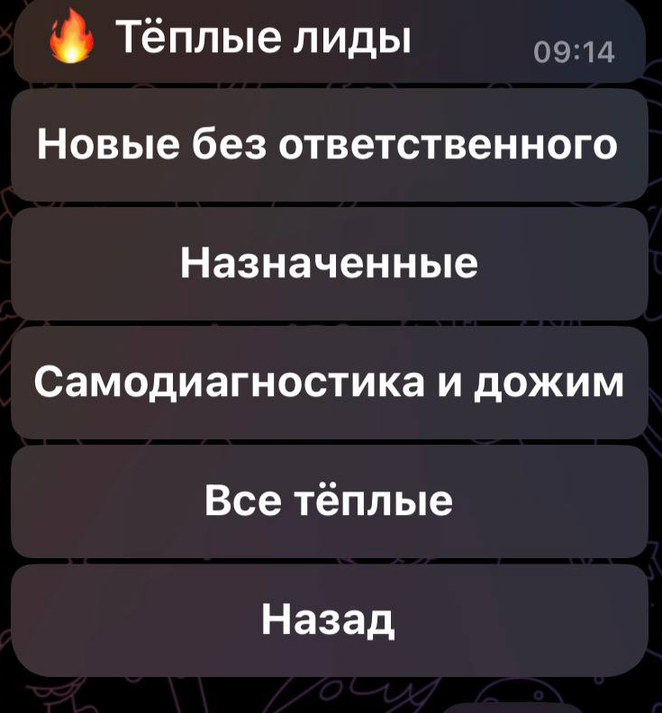

# Learn and Earn CRM

Самостоятельная система продаж: Web CRM, входящий Entry Bot и рабочий Manager Bot. Free и Paid — отдельные образовательные продукты.

Система проектировалась для **примерно пяти сотрудников, включая руководителя отдела продаж**. Это целевой масштаб из CRM-сводки D3, раздел 1, а не подтверждённые пять активных аккаунтов.

**Стек:** React, Python / FastAPI, PostgreSQL, Telegram Bot API, Docker Compose, Ubuntu VPS, Caddy/HTTPS. D3, разделы 2 и 13, подтверждает историческую инфраструктуру и миграции по истории проекта; исходный код и конечные конфигурации в текущем комплекте не проверялись.

**Мой вклад:** проектирование ролей и обработки заявок, постановка задач AI-инструментам, интеграция web и Telegram-сценариев, ручные проверки тёплого и холодного потоков, разбор ошибок окружения и участие в развёртывании.

## Компоненты

| Компонент | Назначение |
|---|---|
| Entry Bot | Telegram ID и источник заявки; регистрация тёплого лида и подтверждение клиенту |
| FastAPI / PostgreSQL | Центральное состояние CRM: лиды, отдельные холодные записи, источники, ответственные и учёт продаж |
| React / Web CRM | Руководительская работа с лидами, командой и учётом; полнота всех задуманных разделов не подтверждена |
| Manager Bot | Назначенные лиды и холодные контакты, рабочие действия и уведомления |
| Compose / Ubuntu / Caddy | Историческое развёртывание сервисов и HTTPS |

Схема отражает логическую ответственность. Точные протоколы уведомлений, auth, URL и инфраструктурная топология не восстановлены. Пунктир не обозначает доказанную очередь или отдельный сервис.

[Mermaid-исходник](architecture/components.mmd) · [SVG](architecture/components.svg)

Оба бота относятся к единой CRM. Общая PostgreSQL не означает общей БД с Free/Paid. Автоматическая синхронизация с прогрессом образовательных ботов не подтверждена (D3, разделы 4, 11, 13).

## Роли и доступ

| Бизнес-роль | Обозначения в источниках | Предусмотренные полномочия и границы |
|---|---|---|
| Владелец | CEO / OWNER в D3; CEO на кадрах | Вся CRM, команда, права, системные настройки и финансовый учёт; предусмотрен запрет удаления последнего активного CEO |
| Руководитель отдела продаж | ADMIN / ROP в D3; COO в D1 и архивном интерфейсе | Тёплые лиды и холодная база, назначения, контроль менеджеров и их учётных записей; без самоповышения до владельца и изменения полномочий CEO |
| Менеджер | MANAGER / МОП | Назначенные лиды и контакты, попытки обращения, ответы и разрешённые статусы через Manager Bot; полноценная административная web-панель не предполагалась |

D3, раздел 3, описывает модель полномочий; D1 и скриншоты используют другое обозначение руководителя. Это сопоставление бизнес-ролей, а не доказательство равенства строк ADMIN/ROP/COO в серверном enum. Полная конечная матрица доступа, запрет удаления последнего CEO, хеширование паролей и изоляция данных менеджеров не прошли независимую проверку. Наличие формы пользователей доказывает интерфейс, а не все ограничения backend.

## Движение заявки

Entry регистрирует тёплую заявку; импорт холодного контакта и действие «Написал» сами по себе лид не создают. У хранилища нет исходящих бизнес-переходов: сохранение статуса не запускает повторное подтверждение или назначение.

[Mermaid-исходник](architecture/lead-flow.mmd) · [SVG](architecture/lead-flow.svg)

**Тёплый поток.** Клиент входит в Entry с source_code; создаётся новый лид, клиент получает подтверждение, руководитель — уведомление и возможность ручного назначения. D1, стр. 1, фиксирует изменение ответственного в web и появление в «Мои лиды». Скриншот повторного входа показывает уже существующий лид; это не доказывает отсутствие конкурентных дублей. D3 исключает автоматическую выдачу бесплатной диагностики из финального входящего сценария: диагностику/анкету менеджер мог выдавать вручную. Ориентир 30 минут — текст интерфейса, а не измеренный SLA.

**Холодный поток.** D3, раздел 6, отделяет Cold Base от лидов: импорт → назначенная пачка → попытка связи → ожидание ответа. Только содержательный ответ позволяет перевод в лид с сохранением связи с исходным контактом и менеджером по описанной модели. D1, стр. 3, подтверждает конкретный результат «ответ → лид появился в CRM». Полная холодная воронка, все отрицательные ветки, поздние ответы и автоматическая выдача пачек не считаются проверенными. Передача руководителю после анкеты, отказы и повторная оплата в D1 остаются контрольным списком без результата.

**Статусы и учёт.** Наблюдаемы «Новый», «Оплатил», очереди без ответственного и назначенных. D3, раздел 5, перечисляет согласованные этапы продаж, но прямо оставляет конечные значения БД неизвестными. Категории «самодиагностика и дожим» на экране не выдаются за точные серверные статусы. Сводки и записи оплат подтверждают интерфейс учёта; эквайринг, точные комиссии, правильность всех расчётов и автоматические выплаты не доказаны.

**Планы и ограничения.** Tasks, Audit Log, полная аналитика, детальные смены/время, автоматический контроль бездействия и автоматическое назначение всех новых лидов описывались как требования либо требуют подтверждения (D3, разделы 7–13). Они не входят в перечень доказанных завершённых функций.

## Архивные экраны

### Entry Bot и уведомления

*Ответ Entry Bot о зарегистрированной заявке и переход к менеджеру.*

*Из одной архивной композиции выделены административные события и повторный вход. Это не сценарий образовательного бота.*

*Источник, атрибуция, контактные поля, статус и действие в течение 30 минут; данные пользователя скрыты.*

### Web CRM

*Сводка, последние лиды и оплаты. Значения на тестовом кадре не используются как коммерческие показатели.*

*Создание сотрудника и роли. Логины, имена, Telegram ID и пароль закрыты. Текст архивной ошибки [object Object] косметически скрыт на утверждённой копии; исправление приложения не заявляется. Правая кнопка была обрезана в оригинале.*

### Рабочий Telegram-интерфейс

*Ролевая сводка руководителя и разделы общей CRM.*

*Очереди заявок по ответственным и этапам. Полный экран центра МОПа в утверждённом основном наборе отсутствует.*

## Интеграция и эксплуатация

D3, раздел 2, относит работающие production-контейнеры, миграции и HTTPS к 9 мая 2026 года. Прежняя выдержка H3 датировала сообщение о деплое 10 мая по Стамбулу; без полной истории точное сопоставление дат не установлено. Здесь заявляется историческое развёртывание в мае, а не текущая доступность домена. Домен, личные имена и учётные данные из исходной сводки в публичные материалы не перенесены.

Web-интерфейс в прежней истории описан как desktop-first. Менеджеры работали через Telegram; полноценная адаптивная web-версия не заявляется. По информации автора, VPS удалён; последняя полная версия CRM и её конфигурации не получены. Повторный запуск и security-аудит не выполнялись. [Источники и границы подтверждения](../docs/evidence.md#crm).
