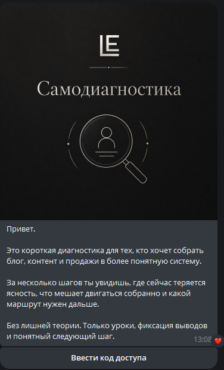
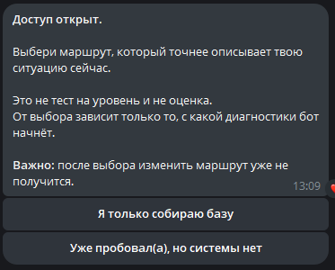
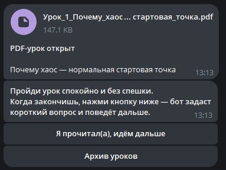
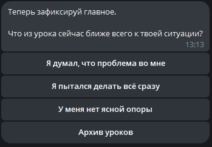
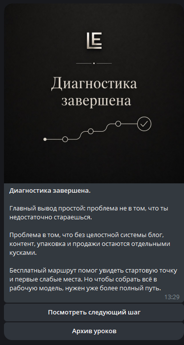
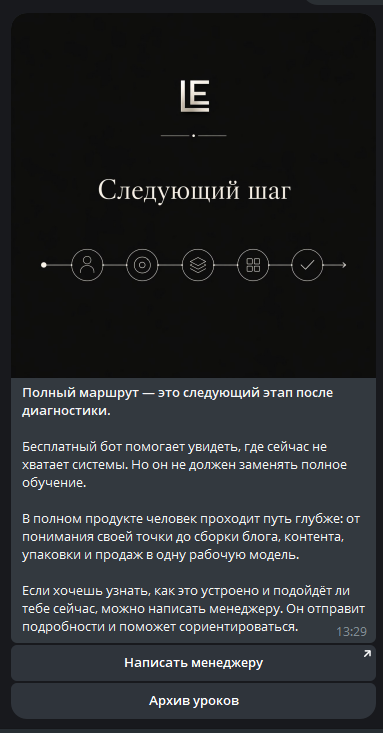
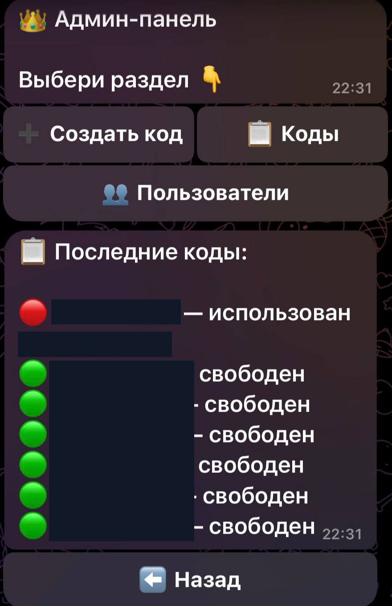
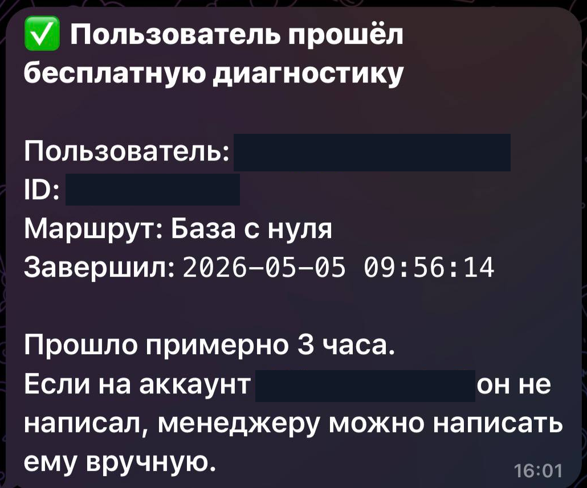
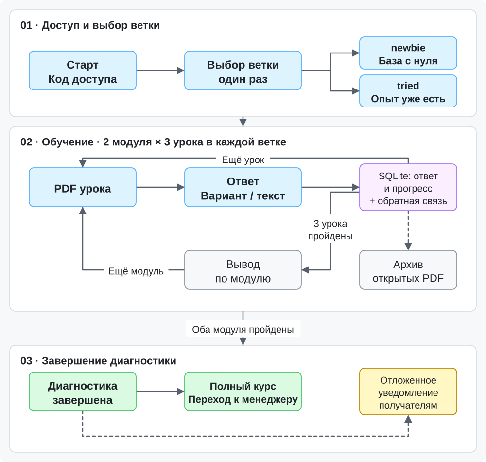
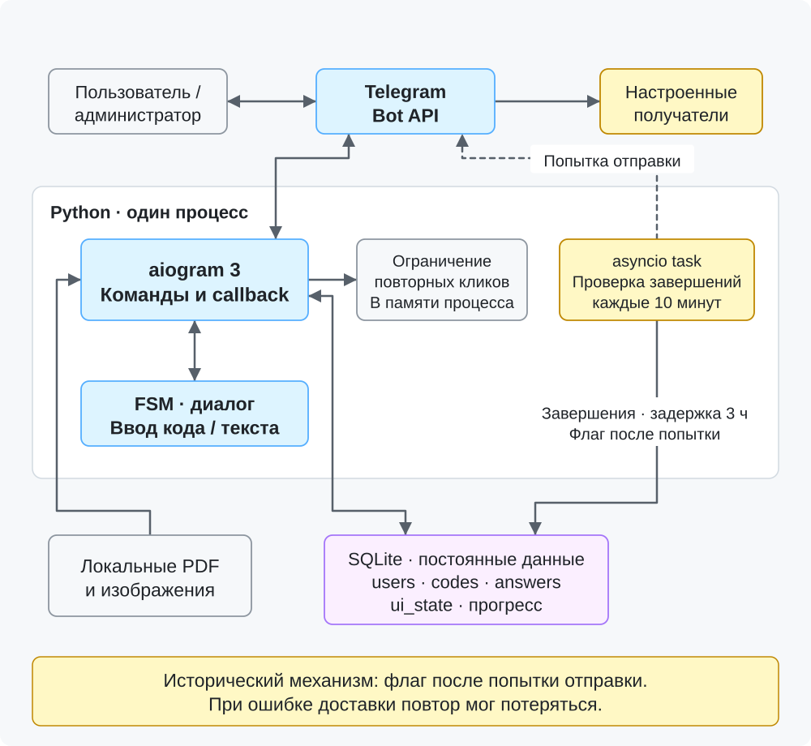

# Learn and Earn Free — диагностический Telegram-бот

**Python · aiogram 3 · SQLite · FSM · Telegram Bot API**

Бесплатный Telegram-продукт для самостоятельной диагностики знаний и последовательного знакомства с образовательной программой Learn and Earn.

Бот проводил пользователя по выбранному маршруту, выдавал материалы, собирал ответы, сохранял прогресс и предлагал следующий этап обучения.

## Реализованная функциональность

- **Два диагностических маршрута:** для новичков и пользователей с предыдущим опытом. Каждая ветка содержит два модуля по три урока.
- **Интерактивное обучение:** PDF-материалы, вопросы с выбором ответа или свободным вводом, обратная связь и последовательное прохождение.
- **Сохранение прогресса:** учёт текущего урока, ответов и ранее открытых материалов в SQLite.
- **Управление доступом:** вход по коду, административная панель, создание кодов и просмотр пользователей.
- **Автоматизация завершения:** финальный результат, предложение полного курса, переход к менеджеру и отложенное уведомление администрации.

## Пользовательский сценарий

**Ввод кода → Выбор маршрута → Уроки и вопросы → Обратная связь → Завершение диагностики → Предложение следующего продукта**

После выбора ветки пользователь проходит уроки по порядку. Прогресс сохраняется, а ранее открытые PDF доступны через архив.

## Интерфейс

### Вход и выбор маршрута

| Стартовая диагностика | Выбор направления |
|---|---|
|  |  |

### Обучение и диагностика

| Выдача PDF-материалов | Интерактивный вопрос |
|---|---|
|  |  |

### Завершение и следующий этап

| Результат диагностики | Переход к менеджеру |
|---|---|
|  |  |

### Администрирование и уведомления

| Управление кодами доступа | Уведомление о завершении |
|---|---|
|  |  |

## Техническая архитектура

**Backend:** Python и aiogram 3 с обработчиками команд, callback-событий и пользовательских состояний.

**Хранение данных:** SQLite — пользователи, коды доступа, ответы, прогресс и состояние интерфейса.

**Управление диалогом:** FSM для ввода кодов и свободных ответов, сохранённое состояние прохождения для переходов между уроками.

**Фоновые процессы:** асинхронная проверка завершений и отложенные уведомления настроенным получателям.

**Развёртывание:** отдельный исторический запуск на Ubuntu VPS.

### Схема пользовательского маршрута

[Открыть SVG](architecture/user-flow.svg) · [Mermaid-исходник](architecture/user-flow.mmd)

### Схема компонентов

[Открыть SVG](architecture/components.svg) · [Mermaid-исходник](architecture/components.mmd)

## Мой вклад

Проект разрабатывался с использованием **OpenAI Codex и ChatGPT**.

В рамках работы я:

- Проектировал структуру модулей, пользовательские маршруты и логику интерфейса.
- Формулировал технические задания для AI-инструментов разработки и проверял результат.
- Тестировал пользовательские и административные сценарии, выявлял ошибки и контролировал исправления.
- Работал с настройкой окружения и серверным развёртыванием приложения.

## Статус проекта

Бот исторически разрабатывался, тестировался и развёртывался на VPS. В настоящее время проект архивный: полный исходный код последней версии и серверное окружение недоступны.

В репозитории представлены техническое описание, схемы и обезличенные изображения интерфейса.

[Подробные технические сведения и ограничения](../docs/evidence.md#free-bot)
