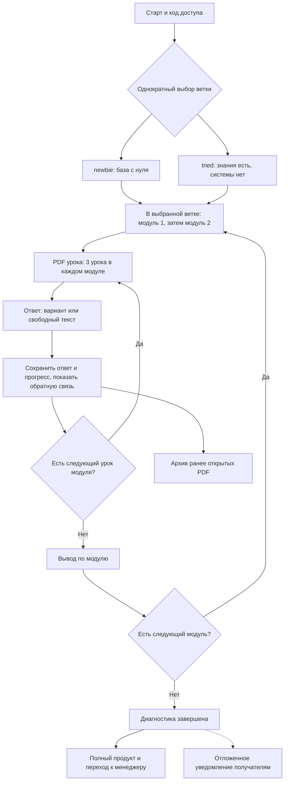
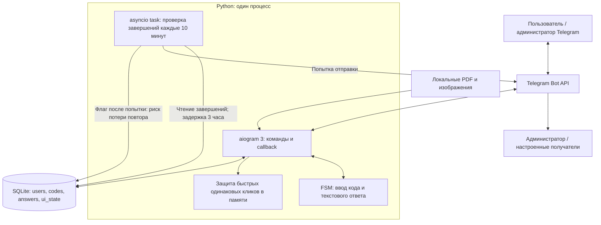
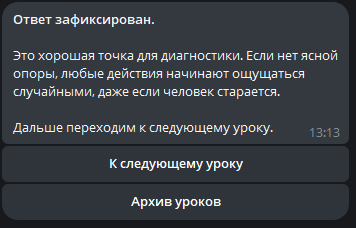
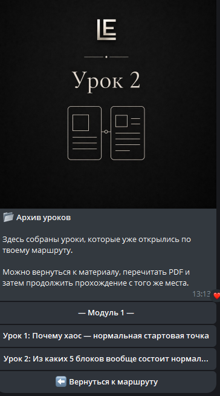
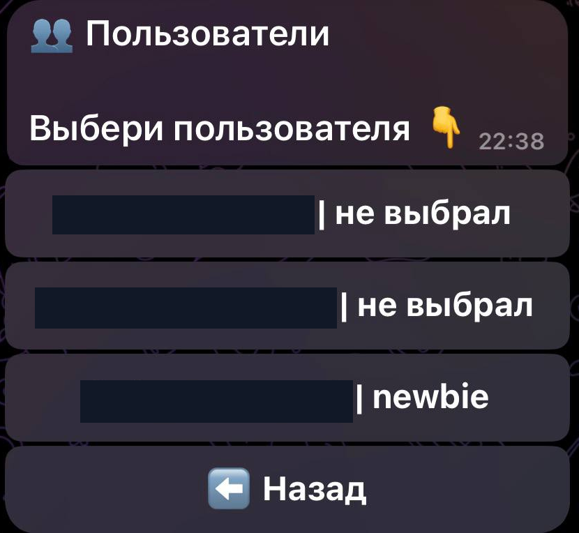

# Learn and Earn Free

Диагностический Telegram-бот: два маршрута, PDF, ответы и прогресс, затем предложение полного продукта и связь с менеджером.

**Стек:** Python, aiogram 3, Telegram Bot API, SQLite, FSM. Основание — технический отчёт D2, стр. 9–18, 23; описанная там ранняя версия и поздние правки не равнозначны единому последнему исходнику.

**Мой вклад:** проектирование маршрутов и экранов, формулирование требований для ChatGPT и Codex, проверка выдачи материалов и переходов, участие в исправлении ошибок и настройке отдельного серверного окружения.

## Сценарий

Доступ открывается по коду. Пользователь выбирает одну из двух независимых веток: «Я только собираю базу» (`newbie`) или «Уже пробовал(а), но системы нет» (`tried`). После выбора изменить ветку нельзя.

В каждой ветке **два модуля по три урока: шесть уроков на ветку, 12 записей уроков суммарно**. D2, стр. 11–12, приводит состав обеих веток по сохранившемуся тексту `data/course.py`. После PDF бот задаёт вопрос с выбором варианта либо свободным текстом, сохраняет ответ и прогресс, показывает обратную связь. После трёх уроков следует вывод по модулю; после второго модуля — финал, оффер и менеджер. Архив открывает ранее доступные PDF. Набор скриншотов показывает только часть этого маршрута.

Схема объединяет одинаковый цикл внутри выбранной ветки; прогресс двух веток не объединяется. Она описывает документированный сценарий, а не повторный прогон конечной версии.

[Mermaid-исходник](architecture/user-flow.mmd) · [SVG](architecture/user-flow.svg)

## Состояния и данные

| Компонент | Подтверждение в D2 |
|---|---|
| aiogram / polling | Стр. 10: запуск Dispatcher и роутеров, фоновая asyncio task |
| FSM | Стр. 13: ожидание кода и текстового ответа; сохранённый прогресс отделён от текущего диалога |
| SQLite | Стр. 14–16: users, codes, answers, ui_state; доступ, ветка, модуль/урок, ответы и message ID |
| Администрирование | Стр. 13: создание и просмотр кодов, пользователи и карточка; вход через /start с проверкой ADMIN_ID |
| Защита кликов | Стр. 17–18: одинаковые callback по паре пользователь/действие ограничивались в памяти процесса |
| Уведомления | Стр. 14: finished/finished_at, задержка 3 часа, проверка раз в 10 минут, флаг попытки уведомления |

Название таблиц и исходная SQLite-модель теперь документально известны. В D2 описаны WAL и глобальный cursor ранней версии; это исторический риск конкурентных операций, а не доказанная устойчивость. Ограничение быстрых кликов не даёт транзакционной идемпотентности. Сохранность незавершённого FSM при рестарте и конечные транзакции не проверены.

[Mermaid-исходник](architecture/components.mmd) · [SVG](architecture/components.svg)

Уведомление направлялось администратору или другим настроенным получателям с рекомендацией проверить контакт с менеджером. Это не Manager Bot из CRM. По D2 флаг устанавливался после попытки отправки: при неудачной доставке возможна потеря повторного уведомления; гарантия однократной успешной доставки не заявляется.

## Архивные экраны

### Вход и выбор маршрута

*Стартовый экран объясняет назначение диагностики и предлагает ввод кода доступа.*

*Два маршрута и запрет смены ветки после выбора.*

### PDF, ответы и продолжение

*PDF отправляется как файл; после чтения пользователь продолжает маршрут кнопкой.*

*Варианты ответа встроены в Telegram-интерфейс.*

*Бот подтверждает фиксацию ответа и предлагает следующий урок.*

*Возврат к открытым урокам и к текущему маршруту. Сокращение длинной подписи кнопки присутствует в исходнике.*

### Финал и следующий продукт

*Финал диагностики с переходом к следующему шагу.*

*Раздел объясняет следующий продукт и предоставляет переход к менеджеру.*

*Служебное уведомление о завершении с маршрутом и временем. Пользовательские идентификаторы скрыты.*

### Администрирование

*Создание кодов, раздел пользователей, использованные и свободные коды. Значения кодов и ID закрашены.*

*Администратор видит пользователей и выбранные маршруты; usernames скрыты.*

## Проверка и эксплуатация

D2, стр. 19, 21, сообщает об успешном локальном запуске и отдельном развёртывании Free на VPS после исправления зависимостей и окружения. Это уточняет прежнюю оценку «деплой не подтверждён». Контейнеризация Free не установлена.

В раннем коде финальный обработчик ожидал другой current_screen. D2, стр. 18, 21, фиксирует передачу исправления Codex, но не извлечённый конечный код. Архивные кадры показывают финал и оффер; они не доказывают закрытие дефекта во всех версиях. Замена длинных вариантов на короткие кнопки также описана как задание, без конечного файла.

Поддержка нескольких администраторов не подтверждена: ранний ADMIN_ID ожидал одно целое число. Полный регрессионный прогон двух веток, повторные клики, рестарты и доставка уведомлений сейчас не выполнялись.

**Архивный статус:** по информации автора, VPS удалены. По D2 часть текста кода Free сохранилась в переписке, но готовый полный комплект последней серверной версии не получен; в этом портфолио приложения нет. [Источники и границы подтверждения](../docs/evidence.md#free-bot).
