# Learn and Earn Paid

Образовательная платформа внутри Telegram: последовательный курс, PDF, практические задания и работа куратора в темах учеников.

**Стек:** Python, aiogram 3, Telegram Bot API, SQLite, FSM. D2, стр. 2–9, 19–24, описывает архитектуру и историческую эксплуатацию; прежний контекст H2 указывает Ubuntu VPS и systemd. Последние исходники и конфигурация сервиса не получены.

**Мой вклад:** проектирование учебной логики и кураторского процесса, постановка задач ChatGPT и Codex, проверка экранов и переходов, уточнение поведения доработок и участие в настройке развёртывания.

## Обучение и прогресс

Курс состоит из **восьми последовательных модулей**. Центр обучения объединяет следующий шаг, кабинет, карту прохождения, архив материалов и связь с куратором. Карта показывает положение ученика и статусы модулей; архив — доступные учебные файлы. Кабинет содержит текущий этап, открытые модули и состояние/историю практики (D2, стр. 5–8).

Полного отдельного кадра кабинета в основном наборе нет. Порядок названий всех восьми модулей по данному набору не восстанавливается; номера и подписи на отдельных архивных кадрах не используются для выдуманного единого списка курса.

## Практика и куратор

Ученик отправлял фото и документы по одному, затем завершал отправку. D2, стр. 6–7, описывает накопление file_id и метаданных в FSM, удаление исходных сообщений с файлами, отдельный нижний экран со счётчиком и создание одной работы с передачей вложений куратору. Там же приведено историческое пользовательское подтверждение механики. Полная сохранность незавершённых вложений при рестарте не доказана.

**Следующий модуль открывался после отправки практики, без обязательного ожидания принятия** — это прямо отмечено в D2, стр. 5, и показано на кадре отправки модуля 3 с кнопкой модуля 4. Ранний H1 связывал доступ с принятием. Дата изменения и применимость каждой архивной версии неизвестны; прежнее утверждение о доказанной хронологии удалено. Статус работы и учебный доступ разделены.

Статусы: `pending` — на проверке, `revision` — доработка, `accepted` — принято. При доработке ученик повторно отправлял файлы; повторное открытие очередного модуля из этого не следует. D2 подтверждает финал после модуля 8, но точное условие финального перехода при незакрытых работах не восстановлено.

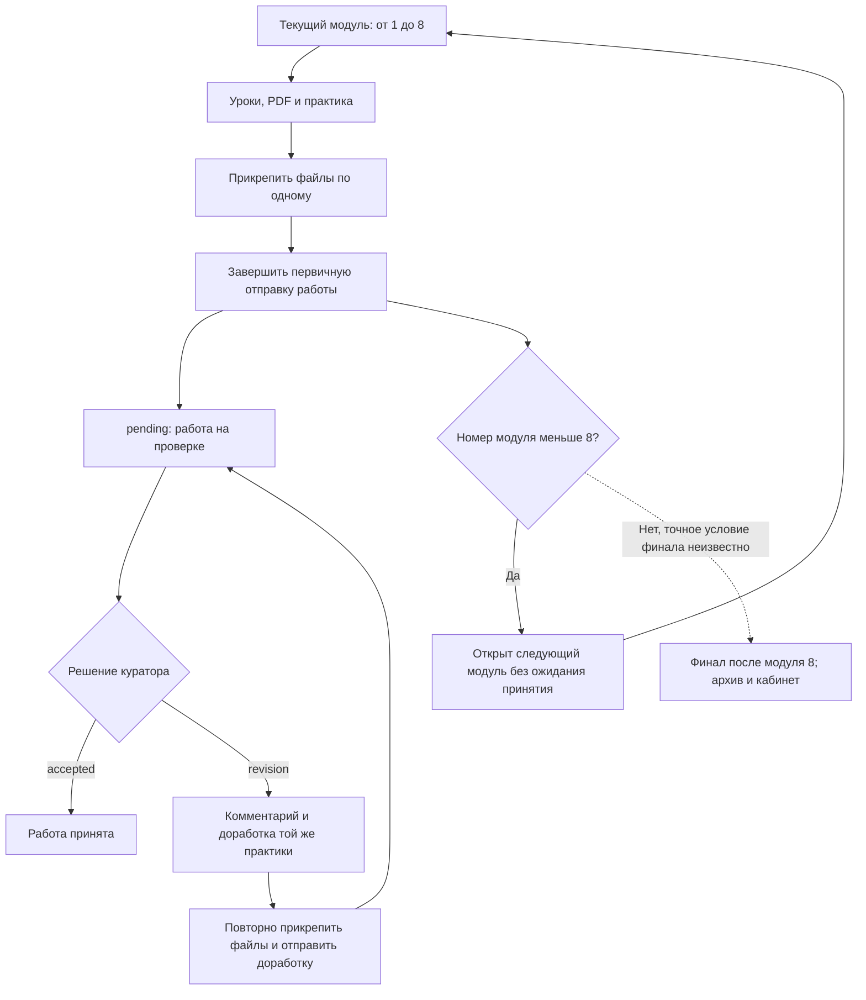

[Mermaid-исходник](architecture/homework-flow.mmd) · [SVG](architecture/homework-flow.svg)

Для учеников создавались темы кураторской группы. Вопросы могли содержать контекст урока, модуля или практики; ответы куратора доставлялись в личный диалог. `/card` показывал карточку ученика. «Прочитано» и «Дополнить обращение» обслуживали обращение. Подробности — D2, стр. 7–9.

`/note` и `!` видны как команды внутренних заметок, но реальное сохранение заметок не подтверждено; `/notes` и история заметок оставались планом (D2, стр. 20, 22). Не следует считать текст подтверждения команды доказательством записи в БД.

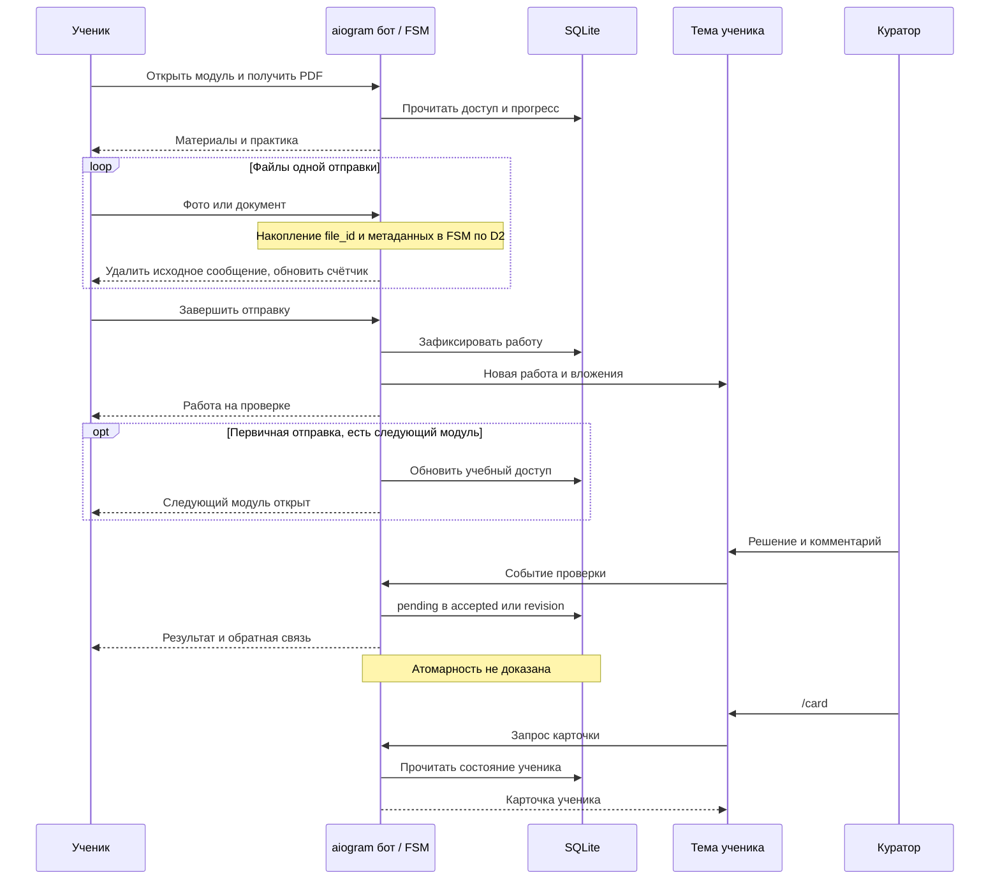

[Mermaid-исходник](architecture/interaction.mmd) · [SVG](architecture/interaction.svg)

## Технические границы

| Область | Что документировано и чего это не доказывает |
|---|---|
| Архитектура | D2, стр. 3–4, перечисляет handlers, keyboards, repositories и services; полный текст большинства Paid-файлов не извлечён |
| SQLite | Ученики, прогресс, работы, обращения и контекст куратора; точный конечный DDL неизвестен |
| Вложения | Мультифайловая отправка подтверждена историей; полное хранение списка в SQLite и атомарность не установлены |
| Админка | Очереди работ/вопросов, пользователи и коды документированы; рассылка упомянута как присутствующая, её корректность не доказана |
| Резервные разделы | Видны кнопки; успешные backup/restore не подтверждены |
| Доступ | В D2 описаны is_admin и DEV_USER_IDS; конечные проверки каждого callback не сверены |

**Известные риски раннего аудита:** действия кураторской группы проверяли chat ID без конкретного пользователя; итоговый whitelist кураторов не подтверждён. Атомарность активации кода и отправки практики, конкурентный SQLite, защита от дублей и корректность исторических счётчиков не доказаны (D2, стр. 8, 20–22). Это исторические замечания, а не утверждение о состоянии каждого позднего файла.

## Архивные экраны

### Учебный интерфейс

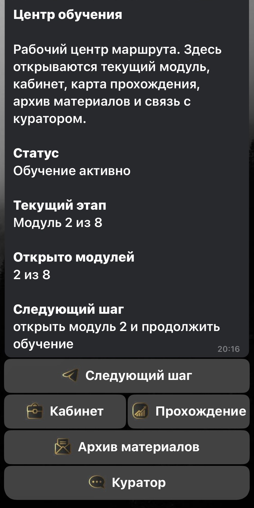

*Навигация, текущий этап и число открытых модулей.*
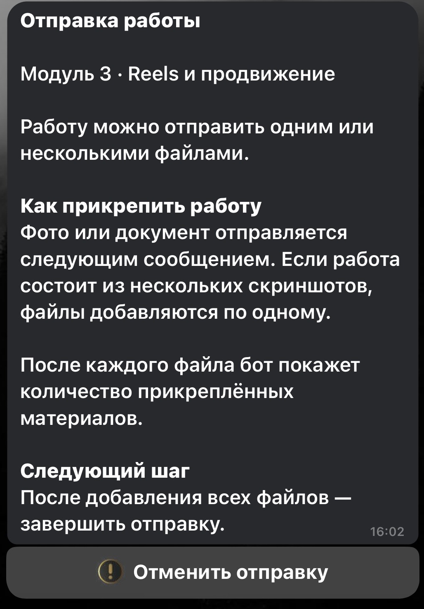

*Инструкция прямо допускает несколько файлов и завершение отправки после их добавления.*
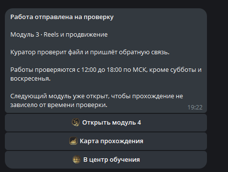

*Подтверждение отправки и кнопка следующего модуля. Текст фиксирует открытие до окончания проверки.*
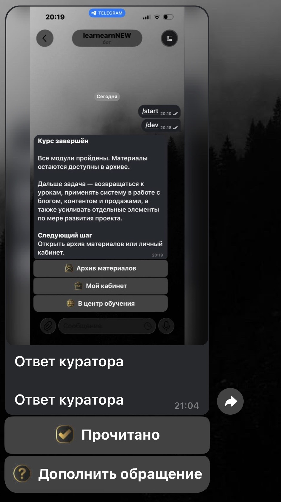

*Ответ с вложением, подтверждением прочтения и продолжением обращения. Содержимое вложения тестовое.*
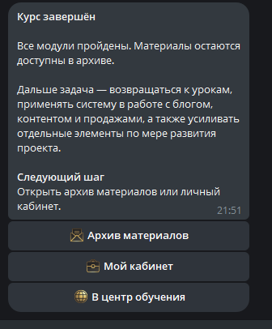

*Финальный экран сохраняет доступ к архиву и кабинету.*

### Кураторский и административный интерфейсы

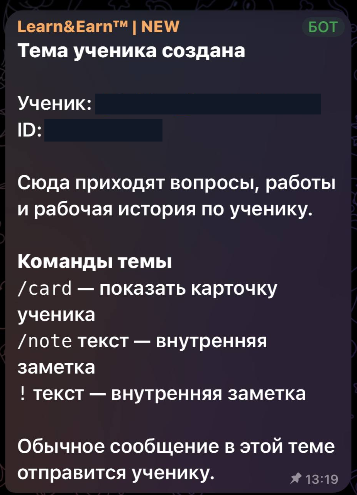

*Отдельная кураторская тема и команды /card, /note. Область неполной следующей карточки не включена в эту копию.*
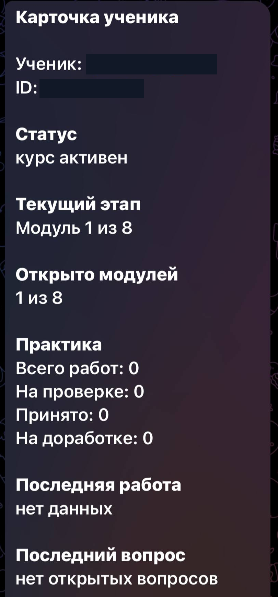

*Статус курса, модули и статистика работ; персональные поля закрашены.*
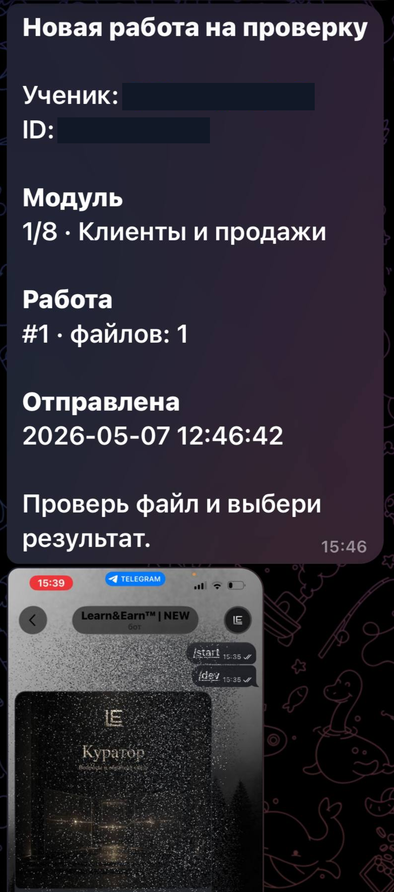

*Уведомление с модулем, числом файлов и вложением. Кнопки решения в исходнике не попали в кадр.*
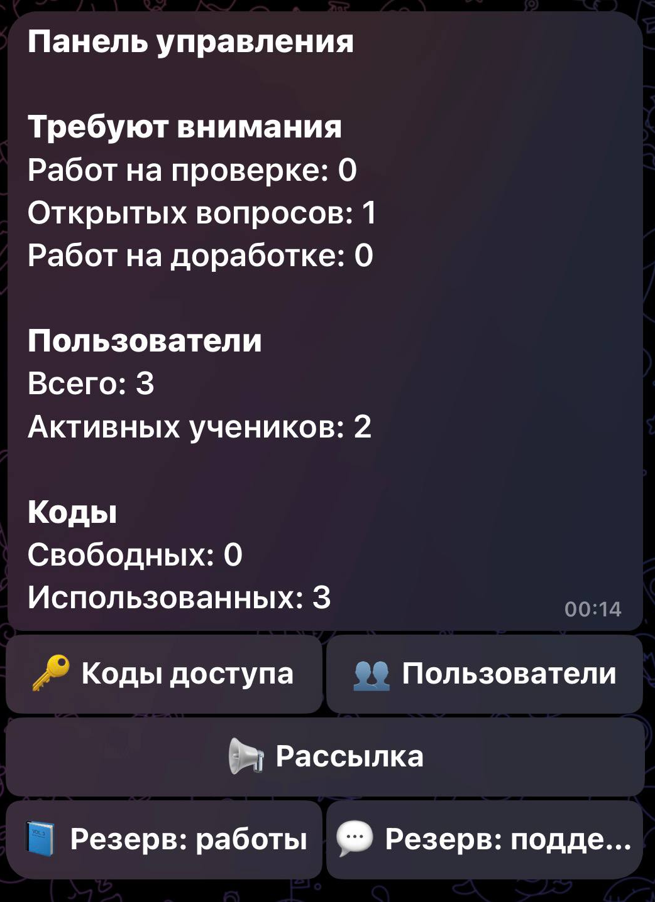

*Счётчики требующих внимания событий, доступы, пользователи и резервные разделы.*

## Тестирование и развёртывание

D2 документирует ручные подтверждения поздней мультифайловой отправки и исторический запуск на VPS. В тестовых вложениях видны `/dev` и `/start`. Наличие DEV_USER_IDS в описании не заменяет проверку всей production-защиты.

В D2, стр. 19, зафиксирован серверный ImportError из-за циклического импорта; доказанного окончательного исправления конфликта finish.png/final.png нет. Поведение старых экранов обсуждалось, но изменение было отложено (стр. 20). Эти инциденты не выдаются за закрытые.

Paid и Free развёртывались как отдельные приложения; Docker для них и общая БД не заявляются. По информации автора, VPS удалены. D2 уточняет: 25 записей Paid-вложений означают метаданные, а не 25 извлечённых исходников; последняя полная серверная версия не получена. Повторного запуска и полного прогона восьми модулей в рамках портфолио нет. [Источники и границы подтверждения](../docs/evidence.md#paid-bot).
