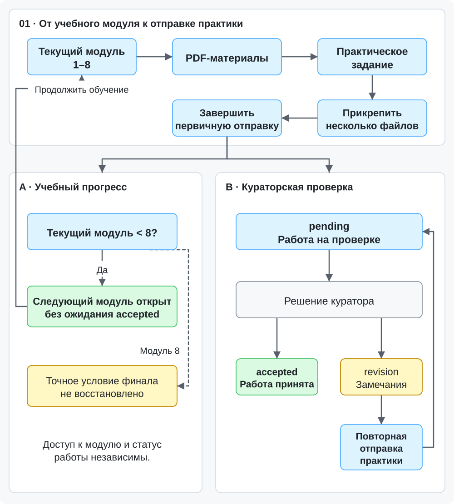
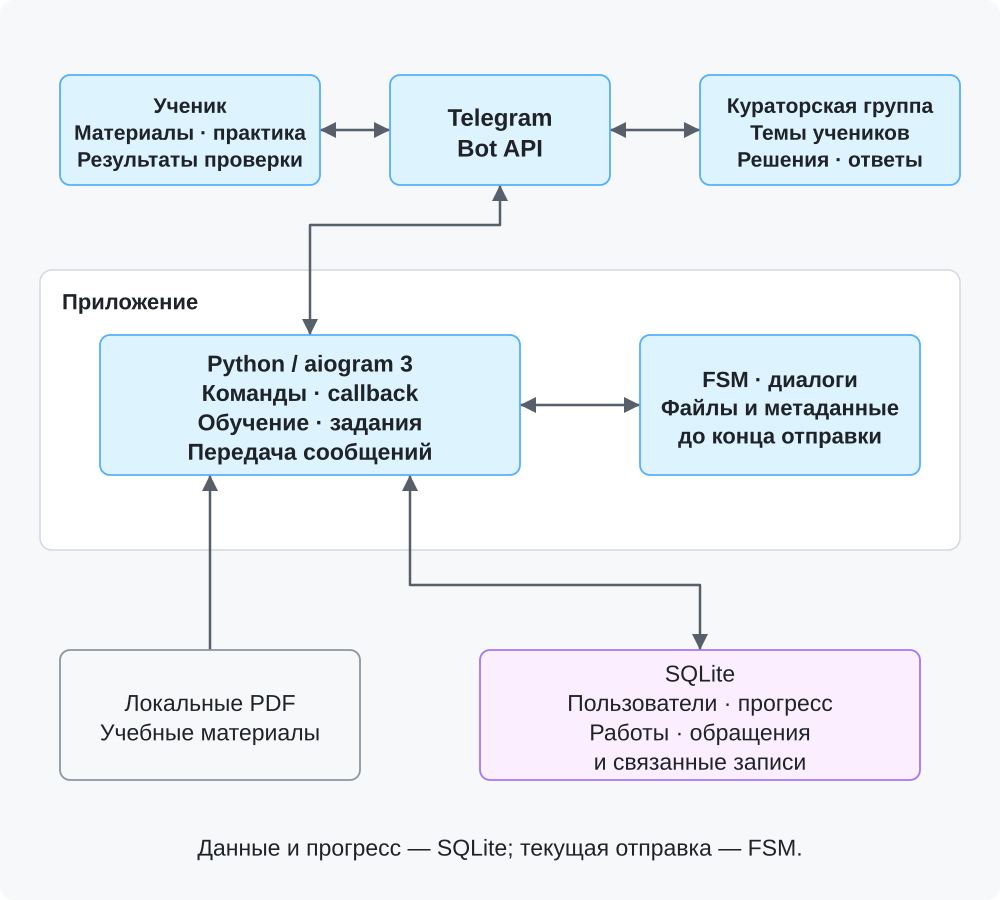

# Learn and Earn Paid — образовательная Telegram-платформа

**Python · aiogram 3 · SQLite · FSM · Telegram Bot API**

Telegram-платформа для последовательного обучения, выполнения практических заданий и взаимодействия учеников с кураторами.

Система объединяла восемь учебных модулей, управление прогрессом, отправку домашних заданий, кураторскую проверку и административные инструменты.

## Реализованная функциональность

- **Восемь учебных модулей:** последовательное обучение с PDF-материалами, картой прохождения и управлением доступом.
- **Личный кабинет:** текущий этап обучения, открытые модули, информация о практических работах и архив материалов.
- **Многофайловые задания:** отправка нескольких фотографий и документов в рамках одной практической работы.
- **Кураторская проверка:** статусы `pending`, `revision`, `accepted`, комментарии и возможность повторной отправки задания на доработку.
- **Коммуникация:** отдельные Telegram-темы для учеников, вопросы с учебным контекстом и ответы кураторов.
- **Администрирование:** коды доступа, пользователи, очереди работ и обращений.

## Как работала платформа

### Обучение

Ученик получал доступ к учебным материалам и последовательно проходил восемь модулей.

Центр обучения объединял текущий этап, карту курса, личный кабинет, архив и связь с куратором.

### Практические задания

После изучения материала ученик мог прикрепить несколько файлов и завершить отправку общей кнопкой.

Бот регистрировал работу, передавал материалы в кураторский процесс и показывал статус проверки.

**Учебный прогресс и проверка заданий были разделены:** следующий модуль открывался после первичной отправки практики, без обязательного ожидания её принятия.

### Работа куратора

Для взаимодействия с учениками использовались отдельные темы Telegram-группы.

Куратор получал контекст работы, мог отвечать на вопросы, проверять практику, принимать её или отправлять на доработку.

Ученик получал результат проверки и мог повторно отправить материалы после замечаний.

## Интерфейс платформы

### Обучение и отправка практики

<table>
<tr><th>Центр обучения</th><th>Многофайловая отправка</th></tr>
<tr><td valign="top"></td><td valign="top"></td></tr>
</table>

### Проверка и обратная связь

<table>
<tr><th>Работа отправлена на проверку</th><th>Ответ куратора</th></tr>
<tr><td valign="top"></td><td valign="top"></td></tr>
</table>

### Кураторский интерфейс

<table>
<tr><th>Отдельная тема ученика</th><th>Карточка ученика</th></tr>
<tr><td valign="top"></td><td valign="top"></td></tr>
</table>

### Управление и завершение

<table>
<tr><th>Административная панель</th><th>Финальный экран курса</th></tr>
<tr><td valign="top"></td><td valign="top"></td></tr>
</table>

## Техническая архитектура

**Backend:** Python и aiogram 3 — обработка Telegram-событий, команд, callback-запросов и учебных сценариев.

**Хранение данных:** SQLite — информация об учениках, прогрессе, практических работах и обращениях.

**Управление состоянием:** FSM — обработка диалогов и накопление файлов в процессе отправки задания.

**Кураторская интеграция:** Telegram Bot API, отдельные темы учеников, сообщения с контекстом и передача результатов проверки.

**Развёртывание:** исторический запуск приложения на Ubuntu VPS с использованием systemd.

### Обучение и проверка практики

[Открыть SVG](architecture/homework-flow.svg) · [Mermaid-исходник](architecture/homework-flow.mmd)

### Взаимодействие компонентов

[Открыть SVG](architecture/interaction.svg) · [Mermaid-исходник](architecture/interaction.mmd)

## Мой вклад

Проект разрабатывался с использованием **OpenAI Codex и ChatGPT**.

В рамках работы я:

- Проектировал структуру восьмимодульной платформы, учебные маршруты и логику переходов.
- Разрабатывал требования к системе домашних заданий, статусам проверки и взаимодействию кураторов с учениками.
- Организовывал AI-assisted разработку, проверял изменения в логике приложения и уточнял технические задачи.
- Тестировал пользовательские, кураторские и административные сценарии, включая отправку нескольких файлов и обработку доработок.
- Участвовал в настройке серверного окружения и развёртывании платформы.

## Статус проекта

Платформа исторически разрабатывалась, тестировалась и запускалась на VPS. В настоящее время проект архивный: последняя полная версия исходного кода и серверное окружение недоступны.

В репозитории представлены описание реализованной функциональности, архитектурные схемы и обезличенные изображения интерфейсов.

[Подробные технические сведения и ограничения](../docs/evidence.md#paid-bot)
